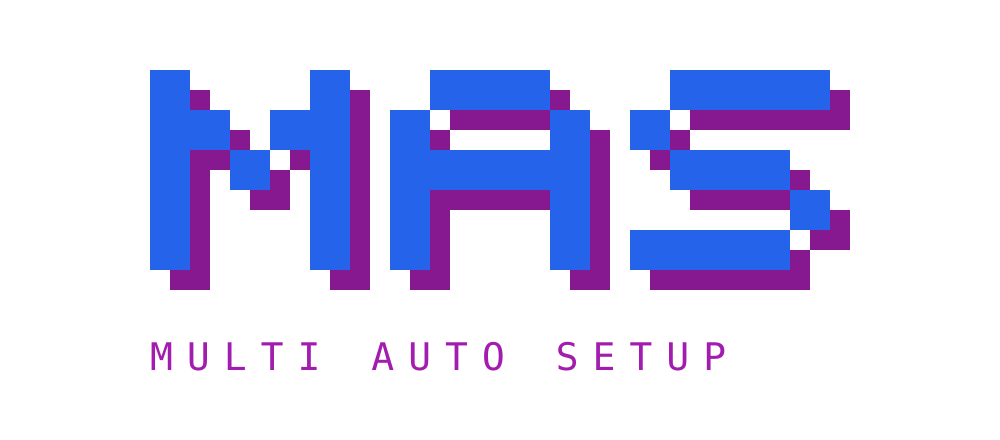
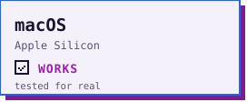
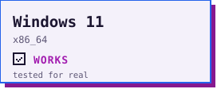
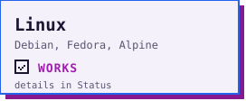
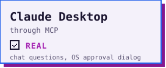
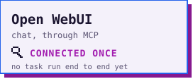
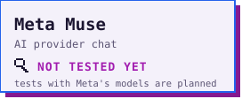
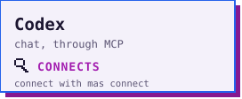
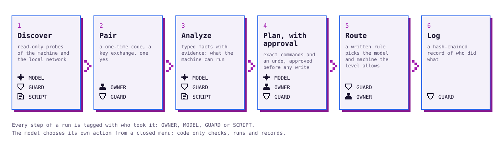

<div align="center">

<picture>
  <source media="(prefers-color-scheme: dark)" srcset="assets/brand/logo-dark.svg">
  
</picture>

**Your computers, working as a team. Your data, on your network.**

[](https://github.com/josuecuguy1307/Multi-Auto-Setup/releases)

-86198F)


</div>

## Works with

Top row: the operating systems. Bottom row: the chats and AI providers that connect through MCP. The word on each tile says how far it went; the [status table](#status) has the detail.

<div align="center">
<picture><source media="(prefers-color-scheme: dark)" srcset="assets/readme/tile-macos-dark.svg"></picture>
<picture><source media="(prefers-color-scheme: dark)" srcset="assets/readme/tile-windows-dark.svg"></picture>
<picture><source media="(prefers-color-scheme: dark)" srcset="assets/readme/tile-linux-dark.svg"></picture>

<picture><source media="(prefers-color-scheme: dark)" srcset="assets/readme/tile-claude-desktop-dark.svg"></picture>
<picture><source media="(prefers-color-scheme: dark)" srcset="assets/readme/tile-open-webui-dark.svg"></picture>
<picture><source media="(prefers-color-scheme: dark)" srcset="assets/readme/tile-meta-dark.svg"></picture>
<picture><source media="(prefers-color-scheme: dark)" srcset="assets/readme/tile-codex-dark.svg"></picture>
</div>

### Connection recipes (not yet tested)

These are written down but have **not** been run end to end. Where a tile exists for one, it says so. Do not read them as support.

- **Open WebUI.** A connection was made once by the owner (the Pipe showed up and an analysis card rendered). No task has been run through it end to end.
- **Terminal agents** (Claude Code, Codex, OpenCode, Muse Code) and **Llama through a local runtime**. Each has a recipe or a catalog entry; none was run for real here.
- **Meta Muse models** (Muse Spark, Muse Wonder). Tests with Meta's models are planned. Muse models run in Meta's cloud; the router never sends confidential tasks there.

## Why MAS

You have several computers and several AIs. Today each AI sees one machine, and you are the glue. MAS is the control layer between **you**, **the AI** and **your machines**: one computer coordinates, the others join with your permission, a local model discovers and sets them up, and every decision that matters is yours. The model chooses its actions; code enforces the rules.

## How it works

<picture>
  <source media="(prefers-color-scheme: dark)" srcset="assets/readme/flow-dark.svg">
  
</picture>

| Stage | What goes in | What comes out |
|---|---|---|
| **1 Discover** | a computer on your own subnet | typed facts about it (hardware, system, programs, local AI runtimes), each with the probe that produced it |
| **2 Pair** | a 6-digit code shown on the coordinator, typed once on the new computer | pinned keys on both sides and your recorded yes; nothing else authorizes a computer |
| **3 Analyze** | the facts | what the machine can run, what is missing, options to choose from (you choose) |
| **4 Plan, with approval** | your pick | a plan with the exact commands, sizes and an undo, bound to a hash; you answer once, a changed plan asks again |
| **5 Route** | a task and its sensitivity level | a written rule picks a model and a machine among those allowed for that level; the reason is shown |
| **6 Log** | every event | an append-only, hash-chained log, each line tagged OWNER, MODEL, GUARD or SCRIPT (the router's choice is tagged ROUTER) |

### Features

| | Feature |
|---|---|
| <picture><source media="(prefers-color-scheme: dark)" srcset="assets/readme/symbols/network-dark.svg"></picture> | **One port.** The coordinator listens on one LAN port; nodes listen on none and always dial out. |
| <picture><source media="(prefers-color-scheme: dark)" srcset="assets/readme/symbols/paired-dark.svg"></picture> | **Pairing by key exchange.** A one-time code is the password of a SPAKE2 exchange; mutual TLS with pinned keys; signed messages. |
| <picture><source media="(prefers-color-scheme: dark)" srcset="assets/readme/symbols/model-dark.svg"></picture> | **A model decides, code guards.** One validated action per turn from a closed menu ([spec](docs/HARNESS_SPEC.md)). |
| <picture><source media="(prefers-color-scheme: dark)" srcset="assets/readme/symbols/approved-dark.svg"></picture> | **Approvals with an undo.** Every write shows the exact action and how to undo it, recorded first. |
| <picture><source media="(prefers-color-scheme: dark)" srcset="assets/readme/symbols/local-dark.svg"></picture> | **Local first.** Data stays on your machines unless you allow otherwise. |
| <picture><source media="(prefers-color-scheme: dark)" srcset="assets/readme/symbols/confidential-dark.svg"></picture> | **Sensitivity levels in code.** `public`, `internal`, `confidential`; a confidential task never goes to a cloud model. |
| <picture><source media="(prefers-color-scheme: dark)" srcset="assets/readme/symbols/guard-dark.svg"></picture> | **A conformance suite** (`conformance/`) that encodes the rules, including that a node opens no listening socket. |
| <picture><source media="(prefers-color-scheme: dark)" srcset="assets/readme/symbols/undone-dark.svg"></picture> | **Undo.** A finished setup can be undone as its own approved run. |

## Safety model

- **Nodes open no ports.** The coordinator opens one LAN port (plus, only if you ask, a screen on this computer's loopback).
- **Pairing needs your code and your yes.** A code lives two minutes and allows one attempt.
- **Read-only by default.** Discovery reads; it writes nothing.
- **Every write is approved** with the exact command and its undo, a fresh approval each time.
- **Confidential never leaves your network.** Enforced when the router chooses and at the node's calls, not by a prompt. Cloud models and commercial harnesses count as cloud.
- **Key names only.** Secrets are entered in a hidden window on your computer, stored in the operating system's credential store, and never pass through a chat, a log or a prompt.
- **Your own machines only.** The software never changes a firewall, network profile or router setting; it tells you what to change.
- **Text from the world is data, never instructions.** Generated code runs only in a sandbox that fails closed, and you approve its exact hash before it touches a device.

Details: [docs/NETWORK_CONTRACT.md](docs/NETWORK_CONTRACT.md).

## Status

<a id="status"></a>

Labels: **REAL** = run on real hardware or real software by a person. **SIMULATED-LOCAL** = real processes on one machine over loopback, or stand-ins for a tool or a cloud API. **LINUX-CONTAINER** = inside a container. **UNTESTED** = code exists, never run there. Labels are never summed.

| Feature | macOS (Apple Silicon) | Windows 11 | Linux |
|---|---|---|---|
| Discovery of a machine | REAL | REAL for 5 of 6 probes, through a paired node | LINUX-CONTAINER |
| Pairing, signed channel, node with no listening port | REAL as the coordinator, with a Windows 11 node (owner-run); also SIMULATED-LOCAL | REAL (as the node, paired with the Mac) | LINUX-CONTAINER |
| Owner's web screen | SIMULATED-LOCAL | UNTESTED | UNTESTED |
| Claude Desktop through MCP (chat questions, OS approval dialog) | REAL | UNTESTED | n/a |
| Setup of a workspace with approvals and undo | SIMULATED-LOCAL | UNTESTED; no real install has run on it yet | LINUX-CONTAINER |
| Installer (`install.sh` / `install.ps1`) | SIMULATED-LOCAL (stand-in release, real `uv`) | **UNTESTED: parsed and its refusal paths run under PowerShell 7 in a Linux container; never run on real Windows** | LINUX-CONTAINER |
| Per-user service | REAL (a LaunchAgent) | UNTESTED | UNTESTED (no systemd in a container) |
| Router, admission exam, board | built; SIMULATED-LOCAL with stand-in environments | UNTESTED | UNTESTED |
| A cloud model through the router (Meta Model API) | UNTESTED: no real call has been made | UNTESTED | UNTESTED |

Not checked anywhere: macOS Intel, Windows arm64, Fedora, Debian on real hardware. Known limits: [docs/KNOWN_GAPS.md](docs/KNOWN_GAPS.md).

## Install

One installer per operating system. Each installs for one user, with no administrator rights, and installs this program only (no AI models). Nothing is signed, so download the script, read it, then run it. Details, uninstall, service, update and unpair: [docs/INSTALL.md](docs/INSTALL.md).

**macOS and Linux**

```bash
curl -fsSLO https://raw.githubusercontent.com/josuecuguy1307/Multi-Auto-Setup/main/install.sh
less install.sh
sh install.sh
```

**Windows 10 and 11 (PowerShell)** (not yet run on real Windows, see the status table)

```powershell
Invoke-WebRequest https://raw.githubusercontent.com/josuecuguy1307/Multi-Auto-Setup/main/install.ps1 -OutFile install.ps1
notepad install.ps1
powershell -ExecutionPolicy Bypass -File .\install.ps1
```

The installers download one pinned release and stop if its SHA-256 differs from the value written in the script. Afterwards: `mas join` on a node, `mas coordinator start --bind ADDRESS` on the coordinator, `mas service install` to start at sign-in, `mas update`, `mas unpair NODE`.

### From a source checkout

Python 3.11 or newer.

```bash
uv venv --python 3.13 .venv && uv pip install --python .venv/bin/python -e .
```

```bash
.venv/bin/python -m pytest conformance
```

## More

- **Harness App standard:** how a chat connects to the harness without being modified: [docs/HARNESS_APP_STANDARD.md](docs/HARNESS_APP_STANDARD.md).
- **Licenses of what is used:** [THIRD_PARTY.md](THIRD_PARTY.md).

## License

The project's license has not been chosen yet. Until one is added, no license is granted.

## Hackathon

Built for the Meta Global AI Developer Hackathon, Indie track. AI-assisted development. Tests with Meta's models are planned.
